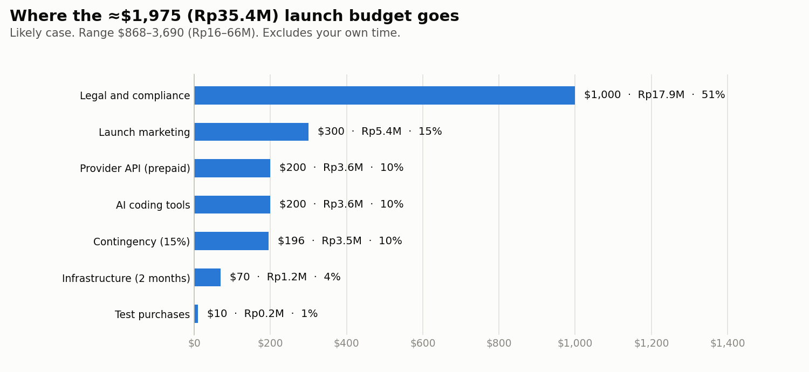
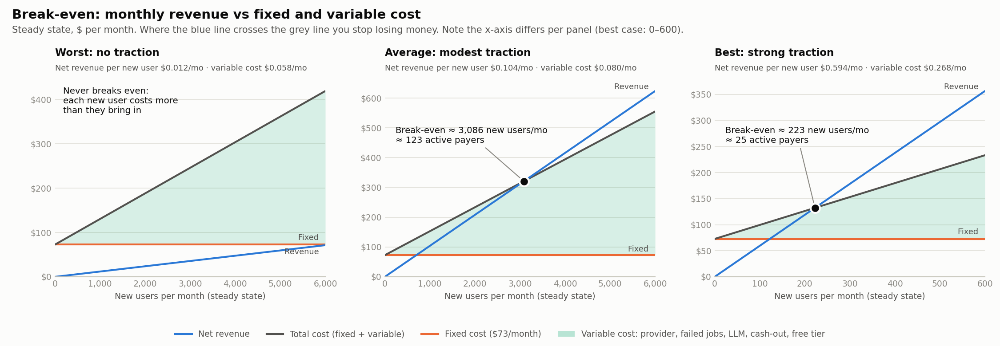
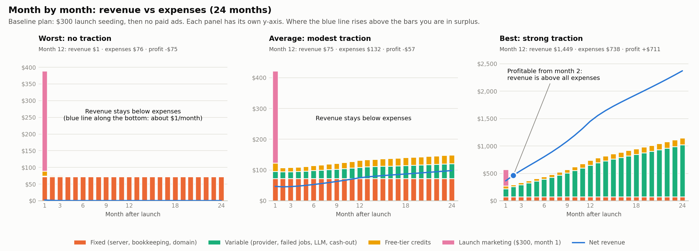
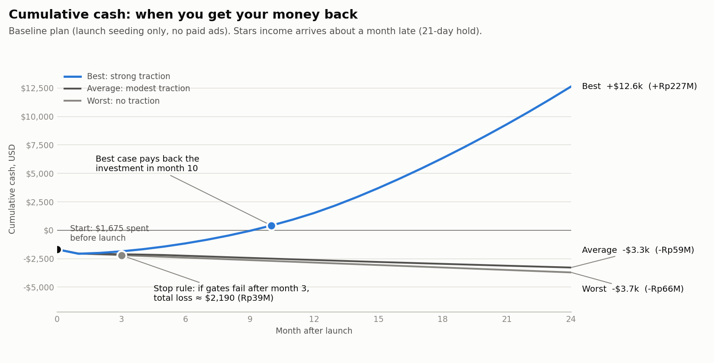

# ai-media-bot — Product & Build Plan

_v5 · 2026-10-08 · decisions D1–D9 locked, R1–R7 and R9 resolved, **R8 (payout eligibility from Indonesia) still open** (§0) · business case §11, marketing §12 · status: scaffold only (no AI, DB, or payments yet)_

**Goal:** A Telegram bot for the **Indonesian market** where users generate **images** and **videos** (text→video, photo→video) from prompts. You subscribe to AI provider API(s) and resell generations as credits, **paid in Telegram Stars**. Providers sit behind adapters so any of them can be swapped in or out.

**Confidence legend:** ✅ verified in official docs · ⚠️ third-party source, verify before relying · ❓ unknown, needs your input or a check.

---

## 0. Decisions

### Locked

| # | Decision | What it means for the build |
|---|---|---|
| D1 | **Indonesia only** | Bahasa Indonesia is the default language (English secondary). Local templates and seasonal packs. Indonesian data-protection law applies (§9). |
| D2 | **Telegram Stars only** | All purchases via `sendInvoice` with currency `XTR`, no provider token. **No QRIS, card, e-wallet or crypto checkout inside the bot:** Telegram's docs say digital goods must be sold exclusively in Stars and anything else gets the bot hidden from mobile users ✅ ([payments docs](https://core.telegram.org/bots/payments-stars)); the Bot Developer ToS adds that non-compliance can lead to store removal or termination ✅ ([ToS §6.2](https://telegram.org/tos/bot-developers)). **QRIS is still very usable by your users to *get Stars*** (§5, "How Indonesian users get Stars"), just not as your checkout. |
| D3 | **SFW only** | Moderation is a launch blocker (M7), tuned for Indonesian sensitivities (§9). |
| D4 | **Provider adapters, easy to plug in or swap** | First-class design requirement, not an afterthought. Core code never imports a vendor SDK. Adding a provider = one file + catalog rows (§6.1). |
| D5 | **Free tier exists** | Image-only, small, watermarked, with a daily free-spend cap (§5). |
| D6 | **You own the bot** | Bot is registered under your Telegram account and Stars payouts go to that account. Keep 2FA on. If the company is meant to receive the revenue, write that arrangement down. |
| D7 | **VPS + Docker, Postgres + Redis** | Replaces the dev tunnel (cloudflared) with a real domain for the webhook. |
| D8 | **Prices shown in rupiah** | Users are *charged* in Stars (Telegram invoices for digital goods can only be in Stars ✅), but every pack and video cost is also shown as an approximate rupiah amount, labelled "perkiraan" (estimate). See §5, "Rupiah display (D8)". |
| D9 | **Payout via Option A** | Stars → Fragment → your TON wallet → Indonesian licensed exchange → your Indonesian bank. No foreign bank account. Eligibility is still to be confirmed (R8). Option B (Telegram Ads credit) stays a possible growth tool (§12). |

### Resolved / agreed

| # | Item | Outcome |
|---|---|---|
| R1 | Net revenue per Star and pack prices | **You earn $0.013 per Star** ✅ (Bot Developer ToS §6.2.4), no commission in that clause, 21-day hold, paid out via Fragment. Pack and item prices worked out in §5. |
| R3 | First provider | **fal.ai** as the first adapter. Confirm its reselling and commercial-use terms before paying (§5). |
| R4 | Free-tier numbers | §5 proposal agreed. Gift raised to 20 credits (see §5 for why). |
| R5 | Niche wedge | Indonesian creators and UMKM: product photos and 9:16 video ads in Bahasa (§2). |
| R6 | VPS region | Close to Indonesia (Singapore or Jakarta); final pick at deploy time. |
| R7 | ToS, privacy and refund policy | Written in Bahasa Indonesia, reviewed by counsel (§9). |
| R2 | How Indonesians buy Stars | **Confirmed by you:** buying Stars with DANA, OVO and GoPay works with no problem. Third-party sources agree for Android ⚠️; iPhone behaviour is still unverified (your note didn't say which device). QRIS works only through third-party top-up sites (§5). |
| R9 | Rupiah pricing | **Your decision:** show prices in rupiah (D8). Remaining task for you: note the rupiah price your Buy Stars screen shows for each Stars bundle, to fill the reference table (§5). |

### Still open

| # | Open item | Status / next action |
|---|---|---|
| R8 | **Can you actually withdraw from Indonesia?** | **Not confirmable from public documents.** Fragment's terms name no countries but reserve the right to limit them ✅; I found no official blocklist and nothing Indonesia-specific ⚠️. Findings, payout options, checklist and tax notes are in §9, "Payout path (R8)". **No foreign bank account is needed** for the default route: Stars → Fragment → your TON wallet → Indonesian licensed exchange → your Indonesian bank. **Plan A agreed (D9).** **Launch gate:** keep paid sales small until your first withdrawal succeeds. Does not block coding. |

---

## 1. What exists today (code review)

A clean FastAPI scaffold, ~110 lines:

| File | What it does |
|---|---|
| [app/main.py](app/main.py) | FastAPI app; sets Telegram webhook on startup |
| [app/routers/webhook.py](app/routers/webhook.py) | `POST /webhook/telegram`, verifies secret token with constant-time compare ✅, hands update to a `BackgroundTask` |
| [app/routers/api.py](app/routers/api.py) | `/api/health`, `/api/send`, `/api/webhook-info`, protected by `X-API-Key` ✅ |
| [app/handlers.py](app/handlers.py) | Echo bot: `/start` → hello, text → "You said…" |
| [app/telegram.py](app/telegram.py) | Thin httpx wrapper: `sendMessage`, `setWebhook`, `deleteWebhook`, `getWebhookInfo` |
| [app/config.py](app/config.py) | pydantic-settings: `bot_token`, `webhook_url`, `webhook_secret`, `api_key` |

**Good foundations:** webhook secret verification, API-key auth, env-based config, `.env` is gitignored.

### Issues to fix before building features

| # | Issue | Where | Impact |
|---|---|---|---|
| C1 | `allowed_updates` = `["message","callback_query"]` — **missing `pre_checkout_query`** | [telegram.py:24](app/telegram.py#L24) | Stars payments will fail. Telegram requires an answer within 10 s ✅ |
| C2 | `drop_pending_updates=True` on **every startup** | [telegram.py:25](app/telegram.py#L25) | A restart can silently discard queued `successful_payment` updates, so a user pays and never gets credits. Remove for prod; add payment reconciliation |
| C3 | Work runs in FastAPI `BackgroundTasks` | [webhook.py:24](app/routers/webhook.py#L24) | In-process, no retry, lost on restart. Video takes minutes. Needs a real job queue |
| C4 | New `httpx.AsyncClient` per call, 15 s timeout, JSON-only | [telegram.py:8](app/telegram.py#L8) | No multipart upload (needed for `sendPhoto`/`sendVideo`), slow, short timeout |
| C5 | Handler ignores everything except `message` | [handlers.py:16-18](app/handlers.py#L16-L18) | No inline-button (`callback_query`) routing, no payments handling |
| C6 | No DB, no user/session state, no update-id dedupe | — | Can't track credits, jobs, or conversation state |
| C7 | Bot token is inside `BASE` URL | [telegram.py:5](app/telegram.py#L5) | If logging is at INFO, the `httpx` logger prints full URLs (including the token). Set `httpx` logger to WARNING |
| C8 | `cloudflared.deb` (19 MB) untracked in repo root | repo root | Don't commit it; add to `.gitignore` or delete |

---

## 2. Positioning: what makes this bot worth paying for

**Honest premise:** every Telegram image/video bot calls the same handful of model APIs. Model access is **not** a moat. The listicles I found ([Uniset AI](https://bottr.me/bots/telegram-ai-image-generator), Beautiful Video AI, etc.) all pitch "many models in one bot" ⚠️. Competing on "more models" is a race you lose on price.

**Where you can win:**

1. **Workflow, not one-shot generation.** Most bots: prompt in → file out. Yours: image → *Animate* → *Variations* → *Upscale* → *Edit* as one-tap buttons under every result.
2. **Fewer wasted credits.** Cheap image preview first, animate only what the user approves. Video is the expensive part; the bot should protect the user's balance.
3. **Trust.** Cost shown *before* spending, **auto-refund on failure**, a clear privacy policy in Bahasa, SFW. Many bots lack all of these.
4. **Bahasa-first.** UI, errors, support and policies in Indonesian. Users type prompts in Bahasa; the bot translates them into a model-ready prompt (most image/video models respond best to English prompts ⚠️ verify by testing your chosen models). Locally relevant templates (§4, F9).
5. **A niche wedge (R5).** *Content for Indonesian creators and UMKM*: product photos plus 9:16 video ads in minutes. A focused promise sells better than "AI image/video generator", and it fits the pricing reality in §5: people who earn from content can justify paying for video.
6. **Viral distribution built in.** Referral credits, watermarked free tier, group/inline mode.
7. **Cost agility.** Because providers are adapters (D4), you can move traffic to the cheapest model that is good enough, or drop a provider that raises prices, without a rewrite. Price is a margin lever you control.
8. **Hand-holding on Stars.** Stars-only is a friction for first-time buyers in Indonesia. A clear Bahasa guide to getting Stars with GoPay/DANA/OVO/QRIS (M9) turns that friction into a trust signal.

---

## 3. User flows

```
/start → language (ID default / EN) → welcome + free credits
 └─ Main menu (inline keyboard; all strings from an i18n catalog)
     ├─ 🖼 Buat Gambar        (Create Image)
     ├─ 🎬 Buat Video         (Create Video)
     ├─ 📸 Animasikan Foto    (Animate a Photo)
     ├─ ✨ Template
     ├─ 💰 Kredit             (Credits / Buy with Stars)
     ├─ 📂 Karya Saya         (My Creations)
     └─ ⚙️ Pengaturan · ❓ Bantuan
```

**Create Image:** prompt → options (tier Fast/Quality/Pro, aspect ratio, count) → **cost preview** → generate → result + buttons `[🎬 Animate] [🔁 Variations] [🔍 Upscale] [✏️ Edit] [📤 Share]`

**Create Video:** mode (text→video / photo→video) → duration → aspect (9:16 / 16:9 / 1:1) → audio on/off (priced separately) → tier Fast/Pro → prompt → **explicit cost confirm** (credits and ≈ Rp) → progress message (ETA, edits in place) → delivered video + `[🔁 Retry] [✂️ Tweak prompt] [📤 Share]`

**Shortcut:** user sends a photo (caption optional) → "What should I do with it?" `[Animate] [Restyle] [Upscale] [Remove background]`

**Out of credits:** show pack buttons (Stars invoice) with an approximate rupiah amount, e.g. `Kreator · 500 Stars (≈ Rp160.000)` (D8), plus `📖 Cara beli Stars` (step-by-step guide, M9). The guide is shown again whenever a user opens an invoice they can't pay (no Stars balance).

**Options are generated from the model catalog** (§6.1): the wizard only offers durations, aspect ratios and audio settings the selected tier's model supports. Swapping the model behind a tier therefore never breaks the UI.

**Rule:** images may be one-tap; **video always needs an explicit confirm with the credit cost**. This prevents accidental spend and refund disputes.

---

## 4. Feature list (prioritised)

**P0 = launch blocker · P1 = launch-quality · P2 = growth.** Size: S/M/L (relative effort, not calendar time).

### Core generation
| ID | Feature | Pri | Size |
|---|---|---|---|
| F1 | Text→image with Fast / Quality / Pro tiers (model names hidden by default) | P0 | M |
| F2 | Text→video, 5 s & 10 s where supported, aspect ratios, async delivery | P0 | L |
| F3 | Photo→video ("animate this photo"): usually the most-requested use case | P0 | M |
| F4 | Inline result buttons: Variations / Upscale / Animate / Retry | P1 | M |
| F5 | Image edit / restyle with a user photo (image→image) | P1 | M |
| F6 | Utility tools: background remove, upscale, photo restore | P2 | M |
| F7 | First-frame + last-frame video, video extend | P2 | M |

### Differentiators (the selling points)
| ID | Feature | Pri | Size | Why it sells |
|---|---|---|---|---|
| F8a | **Bahasa → model-ready prompt translation** (small LLM behind an adapter) | P0 | S | Users type in Bahasa; output quality depends on it |
| F8b | **Prompt assistant**: suggest improvements, show the final prompt, let the user edit | P1 | M | Non-experts get good results → retention |
| F9 | **One-tap templates/presets** (= prompt + tier + params): foto produk, avatar profil, intro iklan 9:16, meme/stiker, cinematic 5 s; seasonal packs (Lebaran, 17 Agustus, Natal, Imlek, Harbolnas/gajian promos, batik, warung/UMKM) | P1 | M | Cheap to build, consistent output, strong engagement |
| F10 | **Image-first → animate** chaining (cheap preview, upgrade to video) | P1 | S | Cuts wasted video spend; unique workflow |
| F11 | **Cost preview + auto-refund** on failure / timeout / moderation block | P0 | M | The trust feature |
| F12 | **Referral**: referee gets a small bonus; referrer is rewarded after the referee's first purchase. Free tier outputs are watermarked ("Dibuat dengan @bot") | P1 | S | Telegram-native growth loop, resistant to self-referral farming |
| F13 | **My Creations**: history, re-run, favourites (own object storage, 7–30 day retention) | P1 | M | Provider URLs expire; users come back |
| F14 | **Live job status**: queue position, ETA, "notify me when done" | P1 | S | Video takes minutes; async UX makes or breaks perceived quality |
| F15 | **i18n catalog: Bahasa Indonesia default, English secondary** | P0 | S | Local edge; cheap now, painful to retrofit |
| F16 | Creator packs: batch 4 variations × 3 aspect ratios, no watermark, priority queue, commercial-use terms | P2 | M | Higher-ARPU segment |
| F17 | Group mode + inline mode (`@bot prompt`), shared credit pool | P2 | L | Viral exposure |
| F18 | Voice-note prompts (speech→text→generate) | P2 | M | Delight, low-effort input |
| F19 | Telegram **Mini App**: gallery, prompt library, buy credits | P2 | L | Richer UX than chat |
| F20 | Subscriptions (monthly Stars) alongside credit packs | P2 | M | Recurring revenue. ⚠️ I recall Stars supports subscription invoices; verify in Bot API docs |

### Platform, monetisation & operations (non-negotiable for a reseller)
| ID | Feature | Pri | Size |
|---|---|---|---|
| A1 | **Provider adapter framework**: interface, registry, normalised request/result/errors (§6.1) | P0 | M |
| A2 | **Model catalog** in DB (tier → model, constraints, unit cost, credit price, enabled flag), editable via admin API without a deploy | P0 | M |
| A3 | **FakeProvider** (instant / delayed / failing / moderation-blocked modes) for dev and CI with zero spend | P0 | S |
| M1 | Credit ledger (append-only), reserve → capture/release, separate `free` and `paid` buckets | P0 | M |
| M2 | Stars purchase flow: `sendInvoice` (XTR) → `pre_checkout_query` → `successful_payment` → credit; store `telegram_payment_charge_id` ✅. Pack sizes follow §5 | P0 | M |
| M3 | `/paysupport`, `/terms`, `/support`, `refundStarPayment` ✅ (Telegram's checklist), all in Bahasa | P0 | S |
| M4 | **Spend guardrails**: daily provider budget cap (sized to your cash float, §5), daily free-spend cap, circuit breaker, per-user rate limits and concurrency limit | P0 | M |
| M5 | Abuse controls: free-tier farming detection, ban list | P1 | M |
| M6 | Admin: grant/revoke credits, ban, stats, toggle a model/provider, provider spend vs revenue (margin per job), **Stars balance, 21-day-hold schedule and payout tracker** | P1 | M |
| M7 | Content moderation (SFW): prompt filter + provider safety flags + real-person/minor/political-deepfake rules (§9) | P0 | M |
| M8 | Free tier (§5) | P0 | S |
| M9 | **"Cara beli Stars" guide** in Bahasa: paying with DANA/OVO/GoPay (confirmed by you), Android vs iPhone steps, QRIS via third-party top-up sites (with a "we can't vouch for third parties" note) | P1 | S |
| M10 | **Rupiah reference prices** (D8): config table of Stars bundle → rupiah, a fallback rate, "perkiraan" label, shown on packs and on the video cost confirm | P1 | S |

---

## 5. Providers, unit economics & free tier

### Recommendation
**Adapter-first (D4).** Build the adapter framework and `FakeProvider` before any vendor integration. **First real adapter: fal.ai** (R3): it lists image and video models from several vendors under one API ⚠️, which gets you to market with one key. Later, add direct adapters for the highest-volume models to improve margin. One comparison puts Seedance 2.0 at ~$0.15/s direct on BytePlus vs ~$0.30/s on fal ⚠️.

**Before paying:** ❓ confirm fal.ai's ToS allows reselling generations to end users inside your product, that commercial use of outputs is permitted for each model you expose, and whether billing is prepaid or postpaid (it changes your cash float, below).

### Indicative provider cost (⚠️ third-party blogs; they disagree with each other, sometimes by 2×. Re-check on each vendor's pricing page before pricing your credits)

**Images (per image, ~1K)**
| Tier | Model | Cost |
|---|---|---|
| Fast | FLUX.2 [klein] | ~$0.001–0.005 per megapixel |
| Fast/Std | Seedream 5.0 Flash / Lite | $0.018 / $0.035 |
| Quality | Nano Banana 2 | $0.067 (Google/Replicate) – $0.08 (fal) |
| Pro | Nano Banana Pro | $0.134 (Google) – $0.15 (fal) |

**Video (normalised to a 5 s clip)**
| Tier | Model | $/sec | ≈ per 5 s |
|---|---|---|---|
| Draft | Veo 3.1 Lite, no audio (preview) | 0.03 | $0.15 |
| Std | Kling v3 Standard (fal), silent / audio | 0.084 / 0.126 | $0.42 / $0.63 |
| Std+ | Kling v3 Pro (fal), silent / audio | 0.112 / 0.168 | $0.56 / $0.84 |
| Budget | Wan 3.0, 720p | ~0.10 | ~$0.50 |
| Premium | Seedance 2.0 720p: BytePlus / fal | ~0.15 / ~0.30 | ~$0.75 / ~$1.51 |
| Premium | Veo 3.1 (fal), silent / audio | 0.20 / 0.40 | $1.00 / $2.00 |

**Takeaway:** a 5 s video costs **~10–100× a single image**. Images are your volume/acquisition product, video is the premium product. This is why the cost-confirm and refund rules in §3 are mandatory.

⚠️ The sources conflict on whether OpenAI's Sora API is still available (one says sunset in Sept 2026). **Do not plan around Sora**; this is exactly what the adapter layer protects you from.

### What you earn per Star (R1)

From Telegram's Bot Developer ToS §6.2.4 ✅ ([source](https://telegram.org/tos/bot-developers)):
- Developers receive rewards equivalent to **$0.013 per Star**. Telegram sets this at its discretion, it is **not tied to what the buyer paid**, and Telegram says it does not expect frequent changes. No commission is mentioned in that clause.
- **Hold:** Star proceeds may not be withdrawable for **up to 21 days** after receipt ✅.
- **Payout** is processed by Fragment, which can limit the countries it serves ✅ (R8: Indonesia is unconfirmed, see §9). Rewards are paid as Gram ($GRAM) to a TON wallet you connect ✅ ([Fragment terms](https://fragment.com/terms)); third-party guides say Gram is the renamed Toncoin and that practical minimums are around 1,000 Stars ⚠️.
- **Refunds and disputes:** if a dispute ends in a refund, you bear it, and Telegram may debit Stars from your balance ✅ (§6.2.1, §6.2.4). Stars on a bot's balance are owned by Telegram until paid out ✅ (§6.2.2).
- ⚠️ One third-party analysis says the app-store cut lands on the *buyer's* price, not on your payout. That matches the ToS wording ("no fixed link"), but confirm in the My Stars screen with your first real sales.
- **Buyer side** ⚠️: a third-party guide quotes $19.99 for 1,000 Stars in the app stores, i.e. buyers pay about **$0.02 per Star** while you net **$0.013**. Every Stars-only bot is in the same position, but users pay ~1.5× what you receive.

### Pricing worksheet (illustrative, calibrate before launch)

```
stars = ceil( provider_cost_usd × markup ÷ 0.013 )      # 1 credit = 1 Star at the base pack price
```
**My assumption (not sourced): markup 3×** on the $0.013 you net. Telegram's cut is already outside this number, so the 3× covers failed jobs, the free tier, infra, FX/exchange costs on Toncoin payout, tax ❓ (R8), support and profit. Keep `stars_net_usd` and `markup` in config; if Telegram changes the reward rate, reprice from one place (admin command recomputes catalog credits from `unit_cost_usd`, with manual override).

| Job | Provider cost | Credits (= Stars) | ≈ Buyer cost in rupiah ⚠️ |
|---|---|---|---|
| Fast image | ~$0.005 | 2 | ~Rp0.6k |
| Seedream Lite image | $0.035 | 9 | ~Rp2.9k |
| Nano Banana 2 image | $0.08 | 19 | ~Rp6k |
| Nano Banana Pro image | $0.15 | 35 | ~Rp11k |
| 5 s Veo 3.1 Lite, silent (draft) | $0.15 | 35 | ~Rp11k |
| 5 s Kling Std, silent | $0.42 | 97 | ~Rp31k |
| 5 s Kling Std, audio | $0.63 | 146 | ~Rp47k |
| 5 s Veo 3.1, audio | $2.00 | 462 | ~Rp147k |

⚠️ The rupiah column uses one reseller's rate (50 Stars from Rp15,946 ≈ Rp319/Star on [Lapakgaming](https://www.lapakgaming.com/id-id/telegram-stars)); real cost varies by payment route and tax. **What it tells you:** images are cheap for Indonesian users, but a 5 s Kling clip (~Rp31k) and premium video (~Rp147k) are priced for people who **earn from content** (creators, UMKM), not casual users. Make a cheap "Hemat" video tier (Veo Lite or Wan) the default and keep premium opt-in.

### Credit packs (proposal)

Pack prices are in Stars. Sizes should line up with common Stars top-up sizes (resellers list a 50-Star minimum ⚠️; verify the in-app bundle sizes when you record the rupiah prices, D8) so users don't end up with leftover Stars. Rupiah amounts below are reference figures at ≈ Rp319/Star, the rate one reseller charges ⚠️; replace them with the prices on your own Buy Stars screen.

| Pack | Price (Stars) | ≈ Buyer cost ⚠️ | Credits | Bonus | ≈ Rp / credit | You net ($0.013/Star) | Effective markup |
|---|---|---|---|---|---|---|---|
| Coba | 50 | ~Rp16k | 50 | none | ~Rp319 | $0.65 | 3.0× |
| Hemat | 150 | ~Rp48k | 165 | +10% | ~Rp290 | $1.95 | 2.7× |
| Kreator | 500 | ~Rp160k | 600 | +20% | ~Rp266 | $6.50 | 2.5× |
| Studio | 1,000 | ~Rp319k | 1,300 | +30% | ~Rp245 | $13.00 | 2.3× |

Bonuses reward bigger packs but eat margin (effective markup = 3 ÷ (1 + bonus)). **Floor: don't let any pack fall below ~2×** (my assumption) until real failure and refund rates are known. Free-gift and referral credits are not Stars revenue; track them separately (§8).

### Rupiah display (D8)

**Charged in Stars, shown in rupiah.** Telegram invoices for digital goods are Stars-only ✅, so the Stars amount is the real price. The rupiah figure is a **reference**: what a user really pays for Stars depends on the store bundle, the payment route and tax, and Telegram's own docs say Star prices vary per user because of VAT and other fees ✅ ([payments docs](https://core.telegram.org/bots/payments-stars)).

1. **Where to show it:** on pack buttons and on the video cost confirm, labelled "perkiraan", e.g. `Kreator · 500 Stars (≈ Rp160.000, perkiraan)`. For cheap image jobs show credits only: a Fast image is ~Rp600, and a precise-looking rupiah figure would be false precision.
2. **Where it comes from:** a `stars_idr_reference` config table (Stars bundle size → rupiah price) filled from the prices your own Buy Stars screen shows, plus a fallback rate (≈ Rp319/Star at one reseller ⚠️). Review it on a schedule (e.g. monthly).
3. **Your margin does not move with the rupiah rate.** You net a fixed $0.013 per Star and pay providers in USD. If the rupiah weakens, users' rupiah cost per Star rises but your USD margin is unchanged, so don't chase it by repricing weekly. Reprice on a schedule.
4. **Disclosure:** the ToS and in-bot text must say the charge is in Telegram Stars and the rupiah amount is an estimate (R7, have counsel check). A rupiah figure that doesn't match the user's store receipt is a trust problem, so keep it labelled and current.
5. **Your own rupiah revenue** arrives later, as Gram sold on an exchange (R8), so what you realise per Star differs from the user-side reference. Track both (§8).

### Cash flow: the 21-day gap
Provider spend is immediate; Star proceeds are withdrawable only after up to 21 days ✅. You need working capital of **at most ~21 days of provider spend**. Example: a $20/day provider cap means up to ~$420 outstanding. Size the daily cap (M4) to what you can float. ❓ If fal.ai is prepaid you top up in advance; if postpaid, check payment terms and spend limits.

**Pricing rules:** credit prices live in the model catalog (A2), not in code. Record `provider_cost_usd` on every job so you can see real margin. The credit price is attached to the **tier**, not the underlying model; if a fallback model costs more, alert (or block the fallback) when margin drops below a floor.

### Free tier (D5, R4): starting proposal, tune with data
- **One-time signup gift: 20 credits** ≈ 10 Fast images (2 credits each in the worksheet). *I raised this from the 10 in the previous draft: with prices now expressed in Stars, 10 credits would only buy 5 Fast images.* Cost to you ≈ **$0.05–0.09 per new user** ($0.05 if all spent on Fast images at ~$0.005; ≈$0.087 at the worksheet's 3× markup: 20 × $0.013 ÷ 3). 1,000 signups ≈ $50–90. These numbers rest on my worksheet assumptions.
- **Image-only.** Free credits live in a separate `free` bucket that cannot be spent on video tiers. The cheapest 5 s clip in the worksheet is 35 credits, so video is gated by purchase anyway. Optionally add one cheap "draft" clip as a conversion hook later, once real costs are known.
- **Watermark** free outputs (server-side). Paid outputs are clean.
- **Expiry:** free credits expire (e.g. 14 days) to drive first purchase.
- **Hard stop on spend:** a **daily free-spend cap** (M4). If today's free generations hit the cap, new signups queue or wait until tomorrow. This is the real protection against farming, because Telegram accounts are cheap to create.
- **Referral:** reward the referrer only after the referee's **first paid purchase**; the referee gets a small bonus on signup. Self-referral loops pay nothing.
- ❓ Phone-number verification would add friction against farming, but it collects personal data (PDP implications). Skip for MVP; revisit if the spend cap keeps triggering.

### How Indonesian users get Stars (R2)

You confirmed that buying Stars with DANA, OVO and GoPay works without problems. That matches what I found, and it means Stars-only (D2) is workable for Indonesian users. QRIS specifically is offered by third-party top-up sites, but it can't be the bot's own checkout. What I found:

**Inside Telegram (official routes)**
- Telegram's Stars ToS ✅ lists purchase through the iOS and Android apps (via the store's in-app purchase), through @PremiumBot (direct-download Android, Web, Desktop), or via a third party such as Apple IAP; "Telegram does not process these transactions" ([source](https://telegram.org/tos/stars)).
- ⚠️ An Indonesian tutorial (late 2025) says Android's Google Play sheet offers GoPay, DANA, ShopeePay, OVO, cards, DOKU and redeem codes ([Mas Hilman](https://www.mashilman.com/2025/11/Tutorial-Mudah-Beli-Bintang-Stars-di-Telegram.html)). A bot vendor's guide says iPhone does not support local e-wallets through Google Pay ([HoneyChat](https://honeychat.bot/id/blog/top-up-telegram-stars-gopay-ovo/)). **Your confirmation covers the e-wallets; iPhone behaviour is still unverified.**

**QRIS**
- I found **no source showing QRIS on Telegram's own purchase screen** ⚠️.
- QRIS and e-wallets are offered by third-party **Stars top-up sites** (e.g. [Lapakgaming](https://www.lapakgaming.com/id-id/telegram-stars), Pitopup, Tokogame) ⚠️. Some deliver manually (one quotes 5–30 minutes, limited hours) and ask for the buyer's Telegram username. That is a scam and support risk the bot can't control.

**What the bot does about it**
1. **M9 guide** in Bahasa with Android and iPhone steps, plus a QRIS section with a "we can't vouch for third parties" note.
2. Shown automatically when a user has no Stars to pay an invoice.
3. Don't link unvetted resellers. Optionally vet one reseller later and disclose any partnership.
4. Track drop-off at the "need Stars" step (§8). If it is high, that is the signal to revisit, not before.

**Why not QRIS as direct checkout?** Telegram's ToS says digital goods must be sold exclusively in Stars and non-compliance can lead to store removal or termination ✅. Termination puts your Stars balance at risk too, since that balance is owned by Telegram until paid out ✅. Whether a checkout *outside* Telegram (a web page selling credits redeemed in the bot) counts as circumvention is not addressed on the pages I read ❓. Treat it as high-risk until Telegram confirms in writing. If you want to explore it later, that is a separate decision, not part of this plan.

---

## 6. Architecture

```
Telegram ──webhook──► FastAPI ──► enqueue job ──► Redis (ARQ) ──► Worker
                         │                                         │
                         ▼                                         ▼
                     Postgres  ◄── ledger / jobs / users ──   Provider registry ──► adapter (fal, fake, …)
                                                                   │ submit / webhook / poll
                      Provider webhook ──► FastAPI ◄───────────────┘
                                                                   │
                       Object storage (R2/S3) ◄── download result ─┘ ──► Telegram sendPhoto/sendVideo
```

### New modules
```
app/
  db.py, models.py          # SQLAlchemy 2 async + Alembic migrations
  telegram.py               # shared httpx client, multipart upload, keyboards, editMessage*, answerCallbackQuery, sendChatAction
  router.py                 # command + callback_query + payment update routing (replaces handlers.py if/elif)
  i18n/                     # id.yaml (default), en.yaml
  state.py                  # per-user wizard state (mode, aspect, tier…)
  billing/                  # ledger, packs, Stars invoices, refunds, reconciliation, free tier
  providers/
    base.py                 # MediaProvider protocol, GenerationRequest/Result, error types
    registry.py             # name → adapter instance, built from settings
    catalog.py              # model_catalog access (DB), tier resolution, fallback chain
    fake.py                 # FakeProvider
    fal.py                  # first real adapter
  llm/                      # same adapter pattern for the prompt translator/assistant
  jobs/                     # ARQ worker, retry/timeout policy, refund on failure
  moderation.py
  presets/                  # templates (data, not code)
  routers/provider_webhook.py   # /webhook/provider/{name} (signature-verified by the adapter)
  routers/admin.py          # extends existing X-API-Key admin API
```

### 6.1 Provider adapter design (D4)

**Goal:** swapping or adding a provider touches **one adapter file plus catalog rows**. Handlers, billing, jobs and UI don't change.

**Interface (sketch):**
```python
class MediaProvider(Protocol):
    name: str

    async def submit(self, req: GenerationRequest) -> ProviderJob: ...        # returns provider_job_id
    async def status(self, provider_job_id: str) -> ProviderStatus: ...       # poll fallback
    async def parse_webhook(self, headers, body) -> ProviderEvent | None: ... # verify signature + normalise
    async def cancel(self, provider_job_id: str) -> None: ...
    def estimate_cost(self, req: GenerationRequest) -> Decimal: ...          # USD, before submit
```

**Normalised types (provider-agnostic):**
- `GenerationRequest`: `kind` (image|video), `prompt`, `negative_prompt?`, `input_images[]`, `aspect_ratio`, `duration_s?`, `resolution`, `audio: bool`, `n`, `seed?`, `model_id` (catalog key). Mapping to vendor-specific parameters happens **inside the adapter**.
- `ProviderResult`: `urls[]`, `mime`, `duration_s?`, `cost_usd_actual?`, `raw` (for debugging only).
- **Error taxonomy** the core understands, which decides refund/retry/fallback: `Retryable` (timeout, 5xx, rate limit) · `ProviderDown` (trigger fallback, trip breaker) · `ModerationBlocked` (refund, tell the user plainly) · `InvalidInput` (refund, show message) · `QuotaExhausted` (alert you, pause model).

**Model catalog (DB table `model_catalog`)**, one row per model offered, seeded from a YAML file, editable via admin API:
`id · kind · tier · provider · provider_model_id · capabilities (text2img, img2img, text2vid, img2vid, audio…) · allowed durations / aspect ratios / resolutions · cost model (per_image | per_megapixel | per_second | per_second_audio) · unit_cost_usd · credits (user price) · priority · fallback_id · enabled`

**How the pieces use it:**
- The wizard (§3) builds its options from the selected tier's catalog row.
- The job runner resolves `tier → primary model → fallback model`, calls the adapter via the registry, records `provider`, `model_id`, `cost_usd`, `credits_charged`.
- Disabling a failing provider is one admin call, not a deploy.

**Rules that keep it pluggable:**
1. Only `providers/<vendor>.py` may import a vendor SDK or know vendor URLs.
2. The core never branches on provider name.
3. **Contract tests** run the same suite against every registered adapter (recorded fixtures for real vendors, live behaviour for `FakeProvider`): submit → status → result, failure, moderation block, webhook signature, cost estimate.
4. **Adding a provider checklist:** implement the protocol · register in `registry.py` · add catalog rows · pass the contract suite. Nothing else.
5. The same pattern covers the **prompt translator/assistant LLM** (`llm/`) and, if needed later, an external moderation service.

### Key design rules
- **Credit ledger is append-only.** Never mutate a balance without a ledger row. Flow: **reserve → capture on success / release on failure**. Prevents double-spend from concurrent requests.
- **Idempotency:** unique constraint on `telegram_payment_charge_id`; dedupe on `update_id`; idempotency key per job.
- **Payments reconciliation:** don't rely only on live updates (C2). Periodically compare against Telegram's Stars transaction history. ⚠️ I believe `getStarTransactions` exists; verify in the Bot API reference.
- **Jobs:** `queued → running → delivered | failed | refunded`; provider job ID, `cost_usd`, `credits_charged`, timestamps. Provider webhook as primary, polling as fallback; hard timeout then auto-refund.
- **`callback_data` ≤ 64 bytes:** store payloads server-side, send short IDs.
- **Result delivery:** download from provider (URLs expire) → store in own bucket → upload to Telegram. ⚠️ Cloud Bot API upload limits (I recall 50 MB for videos) are not confirmed here; check `sendVideo` docs. A self-hosted Local Bot API server allows uploads up to 2000 MB ✅, only needed if you outgrow it.
- **Channel-agnostic core:** jobs, billing and providers must not import Telegram code. The README already names Telegram as the *first* integration target; keeping the core clean makes a second channel cheap. (Stars billing stays Telegram-specific.)
- **Observability:** structured logs, Sentry, `httpx` logger at WARNING (C7), dashboard of cost vs revenue.
- **Secrets and config:** add provider keys, DB/Redis URLs, bucket creds, `stars_net_usd` and `markup` to [app/config.py](app/config.py); extend `.env.example`.

---

## 7. Roadmap

### Phase 0: Foundations (M)
**Pre-work (no code, does not block coding):** record the rupiah price of each Stars bundle from your phone (D8) · work through the R8 checklist in §9 (Telegram/Fragment support, wallet, off-ramp, accountant) · confirm fal.ai reselling terms.
Fix C1–C8 · Postgres + Alembic · shared Telegram client with multipart/keyboards · callback router · i18n catalog (ID/EN) · user model + language · **adapter framework + model catalog + FakeProvider (A1–A3)** · Docker + prod webhook domain · logging hygiene.
**Exit test:** a fake end-to-end flow (prompt → queued job → FakeProvider → delivered result) runs through the real queue and ledger with zero provider spend.

### Phase 1: Image MVP + billing (L)
fal image adapter · ARQ queue/worker · credit ledger with free/paid buckets · Stars packs (§5) + refunds + `/paysupport` `/terms` `/support` in Bahasa · "Cara beli Stars" guide (M9) · Bahasa→English prompt translation (F8a) · cost preview · auto-refund · moderation v1 · free tier + daily spend caps · minimal admin (grant credits, toggle model, stats, Stars balance).
**Exit tests:** (1) a real user buys a pack with Stars, generates an image, a forced failure auto-refunds credits, a Stars refund works end to end; (2) **switching a tier from `fal` to `fake` and back is a catalog change only, with no handler code touched**; (3) the first Stars proceeds clear the 21-day hold and a small withdrawal succeeds (proves R8). **Launch gate:** until a withdrawal has succeeded end to end (needs at least the payout minimum, ~1,000 Stars ⚠️, earned through a second account), run a soft launch with a low daily cap and no paid marketing.

### Phase 2: Video (L)
Text→video + photo→video · 2 tiers (cheap "Hemat" default + Pro) · explicit cost confirm · progress/ETA messages · delivery of large files · timeouts/retries · fallback model.
**Exit tests:** 20 consecutive videos including a forced provider failure with the ledger reconciling to the cent; **a second real provider adapter added without touching core code** (proves D4).

### Phase 3: Differentiators (L)
Prompt assistant (F8b) · templates incl. local packs (F9) · animate chaining (F4/F10) · My Creations (F13) · referral + watermark (F12) · live status (F14).

### Phase 4: Growth (L+)
Subscriptions · Mini App · group/inline mode · voice prompts · creator packs · cost-based provider routing · direct vendor contracts for top models · optional B2B API.

---

## 8. Metrics to track from day one
Cost per job vs credits charged (**gross margin**) · **net revenue per Star** (watch for Telegram changing the $0.013 rate) · Stars on hold vs withdrawable · free→paid conversion · credits purchased per payer · **drop-off at the "need Stars" step** (R2) · activation rate (first output within 10 minutes) · payer conversion within 14 days · Stars per active payer (ARPPU) · CAC by channel vs max affordable CAC (§11.2) · rupiah reference vs actual store price (D8) · rupiah realised per Star after Gram→IDR (R8) · video:image ratio · failure/refund rate · median time-to-video · D1/D7/D30 retention · referral conversion · free-spend and provider-spend vs daily caps (and vs your cash float).

---

## 9. Safety, legal & governance

**Content safety (SFW only, D3; P0)**
- Block sexual content, sexual content involving real people ("nudify"), minors, and non-consensual deepfakes. Prompt filter + provider safety flags + report/ban flow. Keep a minimal moderation log.
- **Indonesia-specific sensitivities (my recommendation, confirm scope with counsel):** also block hate content targeting ethnicity, religion, race or group (SARA), realistic deepfakes of politicians, public officials and religious figures, and fabricated "news"-style imagery. Election periods raise the stakes.
- Photo→video of real people is the highest-risk and highest-demand feature. Add a consent notice, block minors where detectable, and state the rules clearly in the ToS.
- ❓ Check each provider's acceptable-use policy; violations can get your *account* banned, which kills the whole business.

**Privacy / Indonesian law (⚠️ not legal advice; confirm with counsel)**
- With an Indonesia-only audience, UU 27/2022 (PDP Law) applies to the personal data you process. Prompts and uploaded photos are personal data; face photos may be treated as sensitive/biometric ❓.
- Disclose in the privacy policy that images and prompts go to third-party providers (likely overseas). Set a retention period and a delete-my-data command.
- ToS, privacy policy, refund policy and `/paysupport` text should be in Bahasa Indonesia (R7).
- ❓ Indonesian electronic-system-operator registration (Komdigi/PSE) may apply to a service offered to Indonesian users; verify before launch.

**Governance and payouts**
- You own the bot (D6): Stars payouts go to your account. Keep 2FA on and, if the revenue is meant to belong to the company, document that arrangement in writing.
- **Payout path (R8):** see the findings and checklist below. Eligibility from Indonesia is unconfirmed, so don't rely on the revenue until a real withdrawal has worked.
- Stars refunds: you are "solely responsible" for legitimate disputes ✅, and Telegram can debit Stars from your balance ✅. Keep a refund policy (refund undelivered or failed generations; delivered ones are final) and log decisions. ToS §6.2.1 discourages selling instant digital items that can't be reclaimed after a chargeback ✅, so keep refund rules clear.
- Don't make claims you can't back (quality, speed, "unlimited"). Be upfront that this is a new product.

**Payout path (R8): findings and checklist**

*What the sources say*
- Only Stars your bot **earned** can be withdrawn; Stars bought for personal use can't ⚠️.
- Withdrawal goes through **Fragment** to a **TON wallet you connect**. By default rewards are paid as **Grams ($GRAM)**, Fragment may pay in other ways "such as stablecoins", and the currency is Fragment's choice ✅ ([Fragment terms](https://fragment.com/terms) §5.2, §6). Third-party guides say Gram is Toncoin renamed ⚠️.
- **Countries:** Fragment "may limit which countries it operates in" ✅ (§1.4). Its terms name no countries, Indonesia included, and I found no official blocklist ⚠️. The country restrictions third-party guides mention (e.g. Germany) concern *buying* Stars, which is a different thing. **I cannot confirm from public documents that an Indonesian account can withdraw; only Telegram/Fragment or an actual withdrawal can settle it.**
- **Verification:** Fragment's terms mention no KYC; a Stars reseller says ID verification is required ⚠️ (conflicting).
- **Indonesian experience:** Indonesian-language tutorials for the route Fragment → TON wallet → Indonesian exchange → rupiah exist (e.g. on YouTube) ⚠️, which hints it has worked for some Indonesian accounts. I couldn't verify them, they are over a year old, and I found no forum reports with real fees or timings.
- **Fees and minimum:** Fragment states no withdrawal fee ✅ (other platforms may add theirs). Practical minimum ~1,000 Stars (≈ $13) ⚠️.
- **Conversion:** Stars → USD at Telegram's rate ($0.013), then USD → Gram at the CoinMarketCap rate, refreshed about every 5 minutes ✅.

*Options for turning Stars into rupiah (Option A chosen, D9)*

The payout has two hops. **Hop 1: Telegram → crypto wallet**, through Fragment. No bank is involved, and this is where eligibility from Indonesia is unconfirmed. **Hop 2: crypto → rupiah**, through an exchange and then a bank. This hop has Indonesian options.

| Option | Route | Foreign bank? | Verdict |
|---|---|---|---|
| **A. Local licensed exchange** | Fragment → your TON wallet → OJK-licensed Indonesian exchange (e.g. Indodax, Pintu) → sell Gram → your own Indonesian bank | **No** | **Default, recommended** |
| **B. Telegram Ads credit** | Keep Stars inside Telegram and spend them on Telegram Ads to promote the bot | No | Complement for growth, not a payout |
| **C. Company-owned route** | Bot, wallet and exchange/bank accounts held by your company (e.g. the HK entity) instead of you personally | Company bank | Contingency or governance choice; needs advisors |
| **D. Foreign exchange + P2P** | Binance/Bybit/OKX-style platform, sell via P2P to an Indonesian bank | No, but the platform is unlicensed in Indonesia ⚠️ | Not recommended |
| **E. Telegram Wallet (@wallet) P2P** | Cash out inside Telegram | No | Not viable (no IDR) ⚠️ |
| **F. Third-party "Stars buyers"** | Someone pays you for Stars or "withdraws" them for you | n/a | Avoid (likely fraud) ⚠️ |

**A. Local licensed exchange (default).**
- Needs: your Indonesian ID (KTP) for the exchange's KYC, a bank account in your own name, and a TON wallet. Nothing foreign.
- Evidence: Indodax moved TON from BEP-20 to its Mainnet network in September 2024 ✅ ([Indodax](https://blog.indodax.com/informasi-migrasi-jaringan-toncoin-ton/)); Pintu says Gram can be sold to rupiah and withdrawn to a personal bank account ✅ ([Pintu](https://pintu.co.id/blog/tutorial/cara-jual-beli-gram-dan-menukarnya-ke-rupiah), updated 8 Oct 2026). Neither page confirms external Gram deposits, memo rules or the current ticker ❓. Both are widely described as licensed ⚠️; check the current OJK whitelist on ojk.go.id.
- Tax: the platform withholds 0.21% final PPh on the sale ⚠️ (PMK 50/2025).
- Costs: trading fee plus a rupiah withdrawal fee; one old review cites Rp25,000 per withdrawal ⚠️ (stale, check). A fixed fee hurts small withdrawals: 1,000 Stars is only about $13 (≈ Rp233k at Rp17.9k/USD, JISDOR 6 Oct 2026 ⚠️), so withdraw in batches.
- Risks: Fragment eligibility (hop 1); price swing between payout and sale (small if you sell promptly); Fragment may pay in another currency at its discretion ✅; the 21-day hold.

**B. Telegram Ads credit.** Telegram's ToS values each Star at $0.02 of advertising credit ✅ (§6.2.3, may fluctuate), versus $0.013 as cash, i.e. about 54% more value if you spend it on ads. It is not cash and can't pay providers. ❓ I haven't checked whether Telegram Ads accepts your bot promotion, or whether it depends on Fragment eligibility (probably not). Use a share of revenue for growth once A works.

**C. Company-owned route.** Legitimate only if the company genuinely owns and operates the bot. It does not by itself fix Fragment eligibility, which depends on Telegram's and Fragment's rules, and trying to dodge a country restriction would breach their terms ⚠️. It adds company wallet/exchange/bank setup (banks can be cautious with crypto proceeds ❓) and raises tax questions for operators based in Indonesia ❓. Ask an accountant and counsel first, and decide in writing who owns the bot (D6).

**D. Foreign exchange + P2P.** Binance and Bybit are described as not OJK-licensed ⚠️, and Kominfo blocked several foreign exchanges' websites in 2022 and their Instagram accounts in 2024 ⚠️ ([Coinvestasi](https://coinvestasi.com/berita/akun-instagram-milik-exchange-kripto-asing-diblokir-kominfo)). P2P legality is grey and carries counterparty and fraud risk ⚠️; tax is 1%, and you may have to self-remit ⚠️. Last resort only, after advice.

**E. Telegram Wallet P2P.** IDR isn't among the P2P currencies in launch coverage ⚠️ ([CriptoNoticias](https://www.criptonoticias.com/tecnologia/telegram-integra-mercado-p2p-wallet-criptomonedas)), and Indonesia is reported among places where Wallet Pay can't be used ⚠️ ([Cryptometer](https://cryptometer.io/news/telegram-joins-the-crypto-space-with-wallet-pay-integration)). Not viable.

**F. Third-party buyers or cash-out services.** Fragment is the only official withdrawal route, and direct-withdrawal offers outside it may be fraudulent ⚠️. Never hand anyone your account or bot.

**If hop 1 turns out to be blocked for you:** A fails (B may still work for ads). The remaining paths are C, with advice, or revisiting D2 (Stars-only), which would mean accepting the visibility and termination risks of non-Stars checkout. So don't commit to heavy spend or marketing on a Stars-only model until hop 1 is confirmed.

*Checklist before paid launch*
1. Look for the withdraw option in your bot's Stars balance screen. Ask Telegram support and Fragment support, in writing, whether an Indonesian account can withdraw, and keep the replies.
2. Set up the TON wallet you'll connect, and complete any verification Fragment asks for.
3. Choose the off-ramp (Option A is the default). Ask each exchange's support, in writing: do you accept Gram/TON deposits from an external wallet, on which network, is a memo/comment required, what is the minimum deposit, what are the fees, and is the ticker GRAM or TON? TON-family deposits often need a memo/comment, and a transfer without it may not be credited ⚠️. Prefer an Indonesia-licensed exchange.
4. Prove the whole path with a small amount: earn at least the payout minimum through a second account (buying from your own bot may be blocked ⚠️), wait out the 21-day hold, withdraw, sell, receive rupiah in your bank. Rough cost of the test: a second account buys 1,000 Stars for about $20 ⚠️ and you net $13, so it costs roughly $7 plus the 21-day wait.
5. Keep a payout log: date, Stars, Gram received, rupiah realised, fees.

*Tax (⚠️ general information, not tax advice; confirm with an accountant)*
- PMK 50/2025 (in force since 1 Aug 2025): selling crypto on a domestic platform carries a **0.21% final PPh 22** on transaction value (**1%** on foreign platforms, which you may have to self-remit if the platform isn't designated); no VAT on the transfer itself; crypto holdings go in the annual tax return. The rate is under review ([pajak.go.id](https://pajak.go.id/id/artikel/pmk-502025-dampak-nyata-penyesuaian-aturan-pajak-bagi-pemain-kripto), [hukumonline](https://www.hukumonline.com/berita/a/membedah-pmk-50-2025-dan-dampaknya-terhadap-perpajakan-aset-kripto-di-indonesia-lt68930d79e525e/), [DDTC](https://news.ddtc.co.id/berita/nasional/1812625/aturan-baru-pajak-kripto-tak-kena-ppn-tarif-pph-naik)). I inferred, not confirmed, that Gram/TON is treated like any other crypto asset.
- That covers *selling the crypto* only. How the Stars revenue itself is taxed (individual or company, any small-business regime) I have **not** researched. Ask the accountant.

---

## 10. Risks

| Risk | Mitigation |
|---|---|
| **Stars purchase friction for Indonesian users** (D1 + D2) | E-wallet purchase (DANA/OVO/GoPay) confirmed working by you (R2); M9 Bahasa guide; track drop-off at the "need Stars" step (§8); verify the iPhone path |
| **Temptation to add QRIS/e-wallet checkout in the bot** | Not allowed for digital goods ✅; risks hiding the bot from mobile users, termination, and your Stars balance. Keep it out of scope (D2) |
| **Fragment won't pay Indonesian accounts, or the path to rupiah is awkward** (unconfirmed, R8) | Checklist in §9 now; soft launch until a real withdrawal succeeds; confirm in writing that the exchange accepts external Gram/TON deposits and what memo it needs (Indodax moved to Mainnet in 2024 ✅) |
| **Rupiah reference price drifts from what users actually pay** (D8) | "Perkiraan" label, reference table taken from real store prices, scheduled review, disclosure in the ToS |
| **21-day cash gap** between provider spend and withdrawable Stars | Size daily spend cap to your float (§5); confirm fal.ai billing terms |
| **Telegram changes the $0.013 per Star rate** (it is at Telegram's discretion ✅) | `stars_net_usd` in config, margin dashboard, admin command to reprice |
| **Telegram is a narrower channel than WhatsApp in Indonesia** | Partly verified ⚠️: GWI data via Seotal reports monthly use of 58.4% for Telegram vs 90.8% for WhatsApp, while another estimate says only 35–40M users (13–15% of smartphone users) at end-2024. Definitions differ, so treat reach as uncertain. Reach is not the binding constraint; conversion and revenue per user are (§11). Use WhatsApp, Instagram and TikTok for distribution and Telegram for the product (§12); keep the core channel-agnostic (§6) |
| Margin erosion / provider price changes (sources differ by ~2×, prices moved recently) | Costs in the catalog, `cost_usd` per job, repricing without deploy, daily spend cap |
| Provider deprecates a model (e.g. Sora uncertainty) | Adapter layer, fallback model, admin kill-switch |
| Abuse: free-tier farming, NSFW, deepfakes | M4, M5, M7; watermark; daily free-spend cap; image-only free credits |
| Disputes/chargebacks debit your Stars | Clear refund policy, auto-refund failed jobs, logs, `/paysupport` responsiveness |
| Lost payment update → paid, no credits | Remove `drop_pending_updates` in prod, idempotent handler, reconciliation job |
| Uncapped provider bill from a bug/attack | Per-user concurrency, per-day budget, circuit breaker, alerts |
| Commodity competition | Differentiators in §2/§4, niche wedge, not model count |
| **Average-case economics don't cover costs** (§11) | Stage-gated launch with explicit stop/pivot gates (§12.6); fixed costs kept near $73/month; no paid acquisition until measured LTV supports it |
| **Paid acquisition costs more than a user is worth** (§11.2) | Organic and referral first; creators paid in credits; test paid channels only below ~70% of the measured max affordable CAC |
| Telegram/provider account ban | SFW enforcement, ToS compliance, no single-provider dependency |
| Revenue and bot ownership tied to one personal account | 2FA, written record of who the revenue belongs to (D6) |

---

## 11. Business case: investment, break-even, ROI

_Cash view, before income tax, **excluding your own time**. Every figure comes from the model in [docs/plan/model/](docs/plan/model/) and its assumptions; none is a forecast. Rupiah at Rp17,917 per USD (JISDOR 6 Oct 2026, from a news portal ⚠️). To change an assumption, edit `bizmodel.py` and run `python3 charts.py` to redraw the charts (needs matplotlib). Replace the assumptions with measured data after the soft launch (§12.6)._

**Definitions.** *Operating break-even (BEP)* = first month with profit ≥ 0. *Payback* = first month the cumulative cash, including the initial investment, is ≥ 0. *Stars cash arrives about one month late* (21-day hold ✅), which the cash figures include.

### 11.1 What it costs: launch budget, monthly running cost, per-job cost

**One-time launch budget: where the ≈$1,975 (Rp35.4M) comes from**



| Category | Line item | Likely | Range | Basis |
|---|---|---|---|---|
| Legal and compliance | ToS + privacy + refund policy in Bahasa (lawyer draft/review) | $700 (Rp12.5M) | $350–$1,200 | ❓ No Indonesian price data found. A US app-development blog says lawyer-drafted terms cost "a couple thousand dollars"; template generators run about $13–72 ⚠️. Get 2–3 written quotes. |
|  | PDP / PSE registration check and advice | $200 (Rp3.6M) | $100–$400 | ❓ Placeholder. I believe the registration itself has no government fee but did not verify. |
|  | Accountant consult (Stars/Gram income, tax regime) | $100 (Rp1.8M) | $50–$200 | ❓ Placeholder: tax on Stars revenue, Gram sales, and your regime (individual or company). |
| Infrastructure, 2 months of build and beta | VPS, 2 months (DigitalOcean 2 vCPU/4 GB at $24) | $48 (Rp860k) | $16–$96 | ⚠️ DigitalOcean lists $24/month for 2 vCPU/4 GB with 4 TB outbound, the same in every region including Singapore. Low case: Biznet Gio 2 core/4 GB at Rp125k/month, possibly plus 11% VAT ⚠️. |
|  | Server backups, 2 months (20% of server) | $10 (Rp172k) | $0–$19 | ⚠️ DigitalOcean charges 20% of the server price for backups. |
|  | Domain, 1 year | $12 (Rp215k) | $10–$20 | ❓ My estimate; not researched. |
|  | Monitoring / storage / error tracking (free tiers) | $0 (Rp0) | $0–$52 | ✅ Cloudflare R2: 10 GB free, then $0.015 per GB-month, no egress fee. ✅ Sentry Developer plan $0 (5k errors, 1 user); Team plan $26/month (high case). |
| Provider API (prepaid) | Dev and QA generations (~300 images, ~25 clips) | $15 (Rp269k) | $10–$40 | Computed from the §5 prices: 250 Fast + 50 Quality + 20 Pro images, 15 draft + 10 Kling clips ≈ $14.70. |
|  | Sample outputs for marketing templates | $10 (Rp179k) | $5–$25 | Computed: 40 Fast + 40 Quality images and 15 clips ≈ $9.70. |
|  | Prepaid balance for beta + first months | $175 (Rp3.1M) | $85–$335 | ✅ fal.ai bills from a prepaid balance and charges only successful generations ([fal docs](https://fal.ai/docs/documentation/model-apis/pricing), as summarised by search). Minimum top-up and expiry ❓ not found. A third-party site mentions ~$20 free credits for new accounts ⚠️ (not counted). |
| Build tooling | AI coding assistant, ~2 months build (your actual plan price) | $200 (Rp3.6M) | $0–$400 | ❓ Your real subscription price. $0 if you already pay for it for other work. |
| Testing | Purchase tests R8/R9 (spread cost) | $10 (Rp179k) | $10–$30 | R8: a second account buys 1,000 Stars for about $20 ⚠️ and you net $13, so about $7; plus a small R9 purchase. |
| Launch marketing | Seeding: 5 nano creators about Rp1.5M ($84) · video/design tools $30 · prizes $50 · small paid test $100 · reserve $36 | $300 (Rp5.4M) | $150–$500 | ❓ Placeholders; see §12.7. |
| Contingency | 15% of legal, infrastructure, sunk provider spend, tools and tests | $196 (Rp3.5M) | $83–$372 | Buffer for the placeholders above. |
| **Total at launch** | | **$1,975 (Rp35.4M)** | **$868–$3,690 (Rp15.6M–Rp66.1M)** | Of which $1,675 is spent before launch and $300 at launch. |

**Honest status of this table.** The earlier headline of ≈$1,950 was a rounded top-down placeholder. This bottom-up version lands at $1,975, within about 1%, so the headline stands. What changed is that it is now itemised and each line says where its number comes from. **Half of the budget (legal and compliance, $1,000) is still a placeholder with no Indonesian price data**; get quotes before trusting the total. Prepaid provider balance is working capital, not a cost, but I count it as spent to stay conservative.

**Monthly fixed cost** (paid whether or not you have users)

| Line | Likely per month | Range | Basis |
|---|---|---|---|
| Server (DigitalOcean 2 vCPU/4 GB; Postgres + Redis on the same box) | $24.0 (Rp430k) | $7.7–$24.0 | ⚠️ One 4 GB box runs the app, Postgres, Redis and the worker (D7). Not load-tested ❓. Low case: a local VPS such as Biznet Gio ([price list](https://www.biznetgio.com/en/pricelist)). |
| Server backups (20%) | $4.8 (Rp86k) | $0.0–$4.8 | ⚠️ 20% of the server price. |
| Storage, error tracking, uptime (R2 + Sentry free tier) | $1.0 (Rp18k) | $0.0–$29.0 | ✅ Free tiers: R2 10 GB, Sentry Developer plan (includes 1 uptime monitor). High case adds Sentry Team $26/month ([Sentry](https://sentry.io/pricing/)). |
| Domain (amortised) | $1.0 (Rp18k) | $0.8–$1.7 | ❓ $12/year ÷ 12. |
| Bookkeeping (Rp750k; range Rp500k-1.5M) | $41.9 (Rp751k) | $27.9–$83.7 | ⚠️ Mekari Jurnal, an accounting-software vendor, puts micro-business monthly bookkeeping at Rp500k–1.5M ([Jurnal](https://www.jurnal.id/id/blog/harga-jasa-pembukuan/)); I use Rp750k. The biggest swing factor. |
| Managed database (high case only) | $0 | $0–$15 | ❓ Placeholder. |
| **Total fixed cost** | **$72.7 ≈ $73 (Rp1.3M)** | **$36–$158 (Rp652k–Rp2.8M)** | The model uses $72.7. |

**Variable cost** (grows with usage)

| Cost | Size | Basis |
|---|---|---|
| **Provider generation** (the "API cost") | $0.005 for a Fast image up to $2.00 for a 5 s Veo 3.1 clip with audio | §5 price tables ⚠️. fal.ai charges only successful generations ✅, so failed jobs cost you nothing at the provider |
| Failed-job and refund leakage | 3–8% of revenue | Assumption: moderation blocks, retries, goodwill refunds |
| Prompt translation (small LLM) | ≈ $0.00015 per job | ✅ Claude Haiku 5.5 is $0.10 per million input tokens and $0.50 per million output tokens ([pricing](https://platform.claude.com/docs/en/about-claude/pricing)). I assume ~520 input and ~195 output tokens, including the ~30% higher token count the page notes for newer models. The model budgets 2% of revenue to also cover moderation checks and prompt-assistant calls |
| Storage of results | ≈ $0.00002 per image, ≈ $0.00015 per 10 MB video | ✅ R2 at $0.015 per GB-month for a 30-day retention, no egress fee ([Cloudflare](https://developers.cloudflare.com/r2/pricing/)) |
| Bandwidth to Telegram | $0 within the server's included transfer | ⚠️ DigitalOcean includes 4 TB outbound |
| Payment processing | $0 | Stars: Telegram's cut is already inside the $0.013 you net ✅ |
| Telegram Bot API | $0 for normal use | ⚠️ The only fee I found is 0.1 Stars per message for broadcasts above 30 messages per second ✅ (ToS §6.2.5) |
| Cash-out friction | 2–4% of revenue | Exchange fee ❓, 0.21% final tax ⚠️, withdrawal fee about Rp25k per batch ⚠️ (stale) |
| Free-tier credits | $0.03–0.05 per new user | §5 |

### 11.2 Unit economics: what one user is worth

| | Worst | Average | Best |
|---|---|---|---|
| Stars spent per active payer per month | 80 | 200 | 400 |
| What you net per payer-month | $1.04 (Rp19k) | $2.60 (Rp47k) | $5.20 (Rp93k) |
| Contribution margin after variable costs | 35% | 51.5% | 60% |
| Contribution per payer-month | $0.36 | $1.34 | $3.12 |
| Expected payer lifetime | 1.4 months | 2.0 months | 2.9 months |
| Lifetime value per payer | $0.52 | $2.68 | $8.91 |
| **Value of one new user** (LTV × share who pay, minus free-tier cost) = **max affordable CAC** | **-$0.05** | **$0.02** | **$0.33** |
| New users per month needed to cover the $73 fixed cost | never | ~3,090 | ~220 |
| Active payers that implies | never | ~123 | ~25 |
| New users per month needed for $500 profit (Rp9M) | never | ~24,300 | ~1,800 |
| Active payers that implies | never | ~970 | ~200 |

**Why this matters:** at Rp47k per payer-month you net about $2.60, so a payer is worth a few dollars in total. Each new user must repay their own free credits and acquisition cost out of the small share who pay. Buying users for more than the "max affordable CAC" row loses money on every one.

**Correction to the previous version.** The earlier "active payers needed" rows ignored free-tier cost and understated the requirement (average case: 52 payers became ~123; for $500 profit, ~426 payers became ~970 and ~10,650 new users a month became ~24,300). The simulation always included the free tier, which is why the average case never breaks even.

### 11.3 Scenario assumptions

| Driver | Worst: no traction | Average: modest traction | Best: strong traction |
|---|---|---|---|
| Organic new users per month at launch | 50, flat | 400, +6% a month in year 1, then +2% | 1,000, +10% a month in year 1, then +3.3% |
| Share of new users who ever pay | 0.8% | 2.0% | 4.0% |
| Payer monthly retention | 30% | 50% | 65% |
| Stars per active payer per month | 80 (≈ Rp25k) | 200 (≈ Rp64k) | 400 (≈ Rp128k) |
| Blended markup (provider cost share of net revenue) | 2.0× (50%) | 2.6× (38.5%) | 3.0× (33%) |
| Failed-job leakage / LLM / cash-out friction | 8% / 3% / 4% | 5% / 2% / 3% | 3% / 2% / 2% |
| Free-tier cost per new user | $0.05 | $0.03 | $0.03 |
| Cost to buy a user (CAC), if you pay | $1.20 | $0.60 | $0.40 |

**What is anchored and what is guesswork.**
- *Conversion* is anchored on RevenueCat's 2026 report: median download-to-paid conversion of 1.4% for India and Southeast Asia combined, 2.6% for North America, 10.4% at North America's 90th percentile ⚠️ ([RevenueCat](https://www.revenuecat.com/state-of-subscription-apps)). That is mobile subscription apps, not Telegram bots. A vendor blog puts AI-app free-to-paid at 1–3% ⚠️ (unverified), and RevenueCat-based coverage says AI apps keep 21% of subscribers after a year vs 31% for other apps ⚠️ ([PPC Land](https://ppc.land/ai-apps-earn-41-more-per-user-but-churn-30-faster-revenuecat-finds/)).
- *CAC* is anchored on one vendor's Telegram Ads figures of €0.22–0.34 per click ⚠️ ([Adsly](https://adsly.pro/guides/telegram-ads-vs-facebook-ads/)). I assumed about 60% of clicks become a /start and €1 ≈ $1.15, giving ~$0.40–0.65 per new bot user. No Indonesia-specific number found.
- **Everything else (organic volume, Stars per payer, retention, markup mix) is my judgement.** They are placeholders to show the shape, not data.

### 11.4 Results

**Baseline plan "Bootstrap":** $300 launch seeding, then **no ongoing paid ads**.

| | Worst | Average | Best |
|---|---|---|---|
| Cumulative new users, month 12 | ~850 | ~7,200 | ~22,100 |
| Active payers, month 12 | ~1 | 29 | 279 |
| Net revenue per month, month 12 | ~$1 | $75 (Rp1.3M) | $1,449 (Rp26.0M) |
| **Operating profit per month, month 12** | -$75 (-Rp1.3M) | -$57 (-Rp1.0M) | **+$711 (Rp12.7M)** |
| Operating profit per month, month 24 | -$75 | -$51 (-Rp914k) | +$1,223 (Rp21.9M) |
| **Operating BEP** (first profitable month) | never | not within 36 months | **month 2** |
| **Payback of the investment** | never | not within 36 months | **month 10** |
| Cumulative cash, month 12 | -$2,839 (-Rp50.9M) | -$2,613 (-Rp46.8M) | +$1,520 (Rp27.2M) |
| Cumulative cash, month 24 | -$3,705 (-Rp66.4M) | -$3,275 (-Rp58.7M) | +$12,645 (Rp226.6M) |
| Peak cash needed | $4.6k by month 36 if you never stop | $3.9k by month 36 | $2.1k |
| Return on peak cash | n/a | n/a | +74% at month 12; +613% at month 24 |

**The realistic worst case is capped by a stop rule.** If you stop after month 3 because the gates fail (§12.6), the total loss is about **$2,190 (Rp39.2M)**; stopping after month 6 is about $2,406 (Rp43.1M). Without a stop rule it bleeds roughly $75 a month.

**The average case is a slow bleed, not a business.** It loses about $57 a month after the launch and does not break even within 36 months. Read it as "stop or pivot at the gate", not "wait and see".

**Break-even chart: fixed vs variable cost**



How to read it: the orange line is fixed cost (flat), the green band is variable cost stacked on top of it, the grey line is total cost, and the blue line is revenue. You are in profit where blue is above grey.

| | Worst | Average | Best |
|---|---|---|---|
| Net revenue per new user per month | $0.012 | $0.104 | $0.594 |
| Variable cost per new user per month (incl. free tier) | $0.058 | $0.080 | $0.268 |
| Break-even: new users per month | never | ~3,090 | ~220 |
| Break-even: active payers | never | ~123 | ~25 |
| Break-even: net revenue per month | never | $321 (Rp5.7M) | $132 (Rp2.4M) |

**Month by month: when revenue rises above expenses**



Table view of the same data (USD per month):

| Scenario | Month | Revenue | Fixed | Variable | Free tier | Marketing | Profit |
|---|---|---|---|---|---|---|---|
| Worst | 1 | $2 | $73 | $2 | $15 | $300 | -$387 |
|  | 2 | $1 | $73 | $1 | $2 | $0 | -$75 |
|  | 3 | $1 | $73 | $0 | $2 | $0 | -$75 |
|  | 6 | $1 | $73 | $0 | $2 | $0 | -$75 |
|  | 12 | $1 | $73 | $0 | $2 | $0 | -$75 |
|  | 24 | $1 | $73 | $0 | $2 | $0 | -$75 |
| Average | 1 | $47 | $73 | $23 | $27 | $300 | -$376 |
|  | 2 | $45 | $73 | $22 | $13 | $0 | -$62 |
|  | 3 | $46 | $73 | $22 | $13 | $0 | -$62 |
|  | 6 | $53 | $73 | $26 | $16 | $0 | -$62 |
|  | 12 | $75 | $73 | $36 | $23 | $0 | -$57 |
|  | 24 | $98 | $73 | $48 | $29 | $0 | -$51 |
| Best | 1 | $364 | $73 | $146 | $52 | $300 | -$207 |
|  | 2 | $465 | $73 | $186 | $33 | $0 | $174 |
|  | 3 | $554 | $73 | $222 | $36 | $0 | $224 |
|  | 6 | $802 | $73 | $321 | $48 | $0 | $360 |
|  | 12 | $1,449 | $73 | $580 | $86 | $0 | $711 |
|  | 24 | $2,370 | $73 | $948 | $127 | $0 | $1,223 |

**Cumulative cash: when you get the money back**



Table view (USD, cumulative; the start is the $1,675 spent before launch, and month 1 also includes the $300 launch marketing):

| Scenario | Start | Month 3 | Month 6 | Month 9 | Month 12 | Month 18 | Month 24 |
|---|---|---|---|---|---|---|---|
| Worst | -$1,675 | -$2,190 | -$2,406 | -$2,623 | -$2,839 | -$3,272 | -$3,705 |
| Average | -$1,675 | -$2,107 | -$2,238 | -$2,428 | -$2,613 | -$2,952 | -$3,275 |
| Best | -$1,675 | -$1,853 | -$1,152 | -$48 | $1,520 | $6,345 | $12,645 |

**Paid ads make it worse in every scenario (cumulative cash at month 24):**

| Marketing plan | Worst | Average | Best | Best-case payback |
|---|---|---|---|---|
| Bootstrap ($300 once) | -$3.7k | -$3.3k | +$12.6k | month 10 |
| Lean (+$150/month ads) | -$7.4k | -$6.8k | +$11.5k | month 11 |
| Standard (+$400/month) | -$14.1k | -$13.1k | +$9.5k | month 14 |
| Aggressive (+$1,000/month) | -$30.3k | -$28.2k | +$4.8k | month 19 |

The reason is in §11.2: the max affordable CAC ($0.02 average, $0.33 best) is below what Telegram Ads would cost (~$0.40–0.65 per new user ⚠️), so each bought user loses money.

### 11.5 What moves the average case (one change at a time)

| Change | Operating profit per month at month 24 | Break-even |
|---|---|---|
| Base (average) | -$51 | none |
| Share who pay 1% / 3% / 4% | -$76 / -$26 / ≈ $0 | none / none / month 25 |
| Stars per payer 100 / 300 / 400 | -$76 / -$26 / ≈ $0 | none / none / month 25 |
| Payer retention 30% / 65% | -$65 / -$31 | none / none |
| Organic start 200 / 800 / 1,500 a month | -$62 / -$29 / +$9 | none / none / month 19 |
| Year-1 growth 0% / 10% | -$63 / -$36 | none / none |
| Markup 2.0× / 3.0× | -$62 / -$46 | none / none |
| Free-tier cost per user $0.06 / $0.015 | -$80 / -$37 | none / none |

**Takeaways**
1. **No single lever rescues the average case.** "Best" differs from "Average" in all of them at once: conversion, spend per payer, retention, markup and growth. The work is raising revenue per new user, not buying traffic.
2. **Revenue per new user beats traffic.** For $500 a month profit (Rp9M), average economics need ~970 active payers, which is ~24,300 new users a month. Best-case economics need ~200 payers, which is ~1,750 new users a month.
3. **The free tier is a big lever at small scale.** Its cost is the same order as your fixed cost. A/B test the gift (10 vs 20 credits) during the soft launch.

### 11.6 How to read this
- **Cash at risk is small and bounded** (about Rp15.6M–Rp66.1M to start, ~Rp39.2M if you stop after three months), while the best case compounds. That asymmetry is the argument for trying it.
- **It is a gated experiment, not a launch-and-hope.** Success depends on conversion, spend per payer and retention. That is why the plan focuses on a niche (UMKM and creators), templates and a first-win onboarding (§12).
- **Don't buy traffic until measured LTV supports it** (rule in §12.3).
- **Treat all numbers as placeholders** until you have four to eight weeks of real data.

---

## 12. Go-to-market and marketing strategy

### 12.1 Who to sell to (hypotheses to validate in the beta)

| Priority | Segment | Why | Likely spend | Role |
|---|---|---|---|---|
| 1 | **UMKM online sellers** (Shopee, Tokopedia, TikTok Shop, Instagram sellers) | Repeated need for product photos, promo banners and short video ads; pays to save time vs a studio | 300–500 Stars a month | Core revenue |
| 2 | **Content creators, freelancers, small agencies** (TikTok, Reels, Shorts) | B-roll, animated photos, thumbnails, greeting videos; shares output publicly | 300–600 Stars a month | Revenue + organic reach |
| 3 | **Students, hobbyists, casual users** | Curiosity, memes, avatars; low willingness to pay | under 100 Stars | Virality and referrals only; never pay to acquire |

### 12.2 Positioning and message
- **Promise:** *Foto produk dan video iklan dari HP dalam hitungan menit, bayar sesuai pakai, tanpa langganan.* Entry pack is 50 Stars (≈ Rp16k at one reseller's rate ⚠️).
- **Proof points:** sample results per template, automatic credit refund when a job fails, Bahasa support, transparent cost before you pay.
- **Draft lines to test (Bahasa):** "Foto produk rapi tanpa studio. Kirim foto, jadi dalam menit." · "Ubah foto jadi video iklan 5 detik, langsung dari Telegram." · "Gagal bikin? Kredit kembali otomatis."
- **Avoid:** "unlimited" or "gratis selamanya", naming competitors, quality claims you can't show, and any promo featuring real public figures.

### 12.3 Channel plan, cheapest first

| # | Channel | How | Cash | Role and notes |
|---|---|---|---|---|
| 1 | **Product-led loop** | "Dibuat dengan @bot" watermark on free outputs, share buttons to WhatsApp/Instagram/TikTok, referral (F12) | $0 | Cheapest growth, built into the product. GWI data via Seotal puts monthly use at WhatsApp 90.8%, TikTok 78.4%, Telegram 58.4% ⚠️ ([Seotal](https://www.seotal.com/indonesia/digital-marketing-statistics)), so **distribute on WhatsApp/IG/TikTok and keep the product on Telegram** |
| 2 | **Founder-led short video** | 3–5 posts a week on TikTok, Reels and Shorts: before/after product photos, "foto produk → video iklan" demos. CTA is a tracked link `t.me/<bot>?start=tt_<campaign>` | $0 (about 5–8 hours a week, my assumption) | Main organic engine; tests which hooks convert |
| 3 | **Community seeding** | UMKM and online-seller Facebook groups, WhatsApp communities, Telegram groups. Give value first (free template packs, mini workshops), follow group rules, no spam | $0 | High-intent audience |
| 4 | **Creators and micro-influencers** | Pay in **credits plus an affiliate share** (e.g. 20% of referred first purchases as credits), not cash. For reference, agency guides cite roughly Rp200k–1M per post for nano creators and Rp1–5M for micro creators, but sources range from Rp1M to Rp52M per micro post ⚠️ | credits first | **Break-even rule:** new users needed = post cost ÷ max affordable CAC. A Rp1.5M ($84) post needs ~260 new users in the best case and ~3,500 in the average case, so don't pay cash until you measure best-case metrics |
| 5 | **Workshops** with UMKM groups and campuses ("Workshop foto produk AI") via Instagram Live or Zoom | Deep link to the bot at the end | time | Warm leads, good conversion for sellers |
| 6 | **Telegram-native** | Own channel (daily examples, template drops); cross-promos with AI, UMKM and creator channels | $0 | Retention and social proof |
| 7 | **Seasonal campaigns** | Themed template packs and bundles. Harbolnas 12.12 (12 Dec) is the next UMKM peak; Ramadan and Lebaran 2027 are expected around Feb–Mar 2027 ⚠️ **verify the dates**. Also Natal, Imlek, 17 Agustus | small | Peaks in demand for greeting cards and promo videos |
| 8 | **Telegram Ads: last, not first** | Official floor is 0.1 TON per 1,000 impressions (≈ $0.30–0.50 ⚠️). Vendor-reported €0.22–0.34 per click ⚠️ → ~$0.40–0.65 per new bot user (my estimate), above the best-case max affordable CAC of $0.33. Minimums conflict between sources (from "no public minimum" to a $2,000 text-only minimum ⚠️) and funding may need TON bought via Fragment with KYC ⚠️ ([Primores](https://primores.org/articles/how-much-do-telegram-ads-cost)) | n/a in baseline | If you test later, fund with **earned Stars**: Telegram's ToS values a Star at $0.02 of ad credit vs $0.013 as cash ✅ (§6.2.3), i.e. ~35% cheaper per ad dollar. ❓ Eligibility for this ad route unconfirmed |

**Scale rule:** only put cash behind a channel once its **measured CAC is below ~70% of the measured max affordable CAC** (§11.2), so every bought user still leaves margin. Until you have measured LTV, the max affordable CAC is a model estimate; don't trust it.

### 12.4 Conversion funnel and tactics

| Step | Target (average → best) |
|---|---|
| /start → first output within 10 minutes (activation) | ≥ 50% → ≥ 70% |
| New user → first purchase within 14 days | 2% → 4% |
| Payer → repeat purchase within 30 days | 50% → 65% |
| Stars spent per active payer per month | 200 → 400 |

1. **First win in 60 seconds:** template picker → send photo → result, with sample results shown in onboarding.
2. **Upsell at natural moments:** after an image result ("Animasikan?"); when credits run low, show the 50-Star "Coba" pack and what it buys (about 25 Fast images or one draft video clip, per the §5 worksheet).
3. **First-purchase bonus:** +20% credits for 24 hours after the free credits run out. It lowers that purchase's markup from 2.6× to ~2.2×, which is acceptable if it lifts conversion.
4. **Unpaid-invoice follow-up:** if a user opens a pack invoice and doesn't pay, send the "Cara beli Stars" guide after about an hour. Getting Stars is the main friction (D2).
5. **Retention:** weekly template drops, seasonal packs, "Karya Saya" re-runs. Don't spam; broadcasts above 30 messages per second cost 0.1 Stars each ✅ (ToS §6.2.5).
6. **Trust:** visible auto-refund, cost preview before every job, a stated support reply time.

### 12.5 Offers (all priced in Stars, shown with ≈ Rp)
- **Free gift:** 20 credits; A/B test against 10 (§11.5).
- **Entry:** "Coba" 50 Stars as the low-friction first purchase.
- **Referral:** referee gets a small bonus on signup; referrer earns 20% of the referee's first purchase as credits.
- **Seasonal bundles:** e.g. "Paket Lebaran" = greeting templates + the Hemat pack, for a limited time.
- **Guardrail:** keep the effective markup at or above ~2× on every offer (§5).

### 12.6 Launch plan with stop/pivot gates (L = soft-launch day)

| Stage | When | What | Cash | Gate to continue |
|---|---|---|---|---|
| Prep | L−4 weeks to L | Phase 0–1 build, R8/R9 checks, legal texts, 20 sample outputs per template, TikTok/IG account, Telegram channel | ≈ $1.68k (§11.1) | Phase 1 exit tests pass |
| Closed beta | L to L+3 weeks | 50–150 users from your network: 3–5 UMKM sellers, 3–5 creators, free credits, 1:1 feedback | $0 | **Gate 1:** activation ≥ 50%, failure rate ≤ 5%, ≥ 5 paying users |
| Soft launch | L+3 to L+8 weeks | Short-video engine, community seeding, 5–10 nano creators paid in credits | $300 | **Gate 2** (≥ 500 users): ≥ 3% pay within 14 days, ≥ 250 Stars per payer per month, ≥ 40% repeat within 30 days, job cost within ±10% of the catalog |
| Scale or stop | L+8 to L+12 weeks | If Gate 2 passes: test paid channels up to $150 a month (Rp2.7M) and apply the scale rule. If it passes partly: pivot niche, pricing or tier. If it fails two of the three revenue gates: stop or hibernate (fixed cost ≈ $73 a month) | ≤ $150 a month | **Gate 3 (L+12):** profit trend and payer count decide continue, pivot or stop |

The thresholds are my judgement, set between the average and best scenarios. **Timing:** aim for the soft launch at least ~6 weeks before Ramadan 2027 so there is real data before the seasonal peak (dates ⚠️ to verify).

### 12.7 Marketing cash by stage

| Stage | Cash | Notes |
|---|---|---|
| Prep and beta | $0 | Giveaway credits are covered by the free-tier cost already in §11 |
| Soft launch | $300 (Rp5.4M) | Seeding: small cash to nano creators, giveaways |
| Scale test (only if gates pass) | ≤ $150 a month (Rp2.7M) | Scale only per the rule in §12.3 |

---

## 13. Suggested next step
Decisions are locked except R8, which does not block coding. **Phase 0 can start now** on the feature branch: C1–C8 fixes, DB, Telegram client, adapter framework. In parallel, before any paid launch, do the no-code checks: the **R8 checklist** (§9), record the **rupiah bundle prices** (D8), and confirm **fal.ai reselling/billing terms**. Budget about Rp35.4M (§11.1) in stages, and treat the launch as a gated experiment (§12.6).

---

## Sources
- Telegram Stars / digital goods (✅ official): https://core.telegram.org/bots/payments-stars
- Telegram Bot Developer ToS, §6.2 and §6.2.4 (✅ official): https://telegram.org/tos/bot-developers
- Telegram Stars ToS, purchase routes and refunds (✅ official): https://telegram.org/tos/stars
- Telegram Bot API (✅ official; Local Bot API limits): https://core.telegram.org/bots/api
- Fragment terms: rewards in Gram, country clause, conversion (✅ official): https://fragment.com/terms
- Crypto tax in Indonesia, PMK 50/2025 (⚠️ secondary): [pajak.go.id](https://pajak.go.id/id/artikel/pmk-502025-dampak-nyata-penyesuaian-aturan-pajak-bagi-pemain-kripto) · [hukumonline](https://www.hukumonline.com/berita/a/membedah-pmk-50-2025-dan-dampaknya-terhadap-perpajakan-aset-kripto-di-indonesia-lt68930d79e525e/) · [DDTC](https://news.ddtc.co.id/berita/nasional/1812625/aturan-baru-pajak-kripto-tak-kena-ppn-tarif-pph-naik)
- Indodax moved Toncoin from BEP-20 to Mainnet, Sept 2024 (✅ exchange's own blog): https://blog.indodax.com/informasi-migrasi-jaringan-toncoin-ton/
- Pintu: sell Gram to rupiah (✅ exchange's own blog, updated 8 Oct 2026): https://pintu.co.id/blog/tutorial/cara-jual-beli-gram-dan-menukarnya-ke-rupiah
- Licensing, blocking and regulation background (⚠️ secondary): [Pluang: OJK-licensed apps](https://pluang.com/akademi/berita-analisis/aplikasi-crypto-berizin-ojk) · [Coinvestasi: Kominfo blocks foreign exchanges](https://coinvestasi.com/berita/akun-instagram-milik-exchange-kripto-asing-diblokir-kominfo) · [ABNR: Law 4/2026](https://www.abnrlaw.com/news/indonesias-p2sk-law-amendment-what-law-42026-changes-for-crypto-and-digital-financial-assets)
- Telegram Wallet P2P and Wallet Pay (⚠️ launch-era coverage): [CriptoNoticias](https://www.criptonoticias.com/tecnologia/telegram-integra-mercado-p2p-wallet-criptomonedas) · [Cryptometer](https://cryptometer.io/news/telegram-joins-the-crypto-space-with-wallet-pay-integration)
- Withdrawal mechanics and country notes (⚠️ third-party): [telestars.io payouts](https://telestars.io/blog/telegram-stars-payouts) · [mystars.tg country guide](https://mystars.tg/blog/telegram-premium-stars-country-restrictions-guide)
- Buying Stars in Indonesia (⚠️ vendor/blog): [Lapakgaming](https://www.lapakgaming.com/id-id/telegram-stars) · [Mas Hilman tutorial](https://www.mashilman.com/2025/11/Tutorial-Mudah-Beli-Bintang-Stars-di-Telegram.html) · [HoneyChat guide](https://honeychat.bot/id/blog/top-up-telegram-stars-gopay-ovo/) · [Pitopup](https://pitopup.com/en/telegram-stars)
- Stars payout and buyer price (⚠️ third-party): [adminhub: withdraw Stars](https://adminhub.tools/blog/withdraw-telegram-stars/) · [DEV: app-store cut hits the buyer](https://dev.to/landstrider/telegram-stars-payouts-the-app-store-cut-hits-the-buyer-not-you-2bk3)
- Video API pricing (⚠️ third-party): [AI Video Generation API Pricing](https://www.buildmvpfast.com/api-costs/ai-video) · [Atlas Cloud](https://www.atlascloud.ai/blog/tips/cheapest-ai-video-generation-api-2026) · [teamday.ai (Sep 2026)](https://www.teamday.ai/blog/ai-api-pricing-comparison-2026) · [Crazyrouter](https://crazyrouter.com/en/blog/ai-video-generation-api-pricing-comparison-2026) · [seeddance.io](https://www.seeddance.io/blog/ai-video-api-pricing-comparison)
- Image API pricing (⚠️ third-party): [pricepertoken.com](https://pricepertoken.com/fal-ai-pricing) · [linkmodel.ai](https://www.linkmodel.ai/blog/cheapest-image-api) · [fal.ai](https://fal.ai/learn/tools/best-image-to-image-apis-2026)
- Competitor bots (⚠️ listicles, unverified): [bottr.me](https://bottr.me/bots/telegram-ai-image-generator)
- Conversion and retention benchmarks (⚠️ mobile subscription apps, not Telegram bots): [RevenueCat State of Subscription Apps 2026](https://www.revenuecat.com/state-of-subscription-apps) · [PPC Land summary on AI apps](https://ppc.land/ai-apps-earn-41-more-per-user-but-churn-30-faster-revenuecat-finds/)
- Telegram Ads pricing (⚠️ vendors, figures conflict): [Adsly](https://adsly.pro/guides/telegram-ads-vs-facebook-ads/) · [Primores](https://primores.org/articles/how-much-do-telegram-ads-cost)
- Telegram reach in Indonesia (⚠️ survey aggregators, definitions differ): [Seotal (GWI)](https://www.seotal.com/indonesia/digital-marketing-statistics) · [Hashmeta](https://hashmeta.com/blog/telegram-statistics-southeast-asia-complete-growth-market-analysis/)
- Influencer rates (⚠️ agency and marketplace estimates, very wide ranges; figures not individually traced): [Elev8or](https://www.elev8or.io/find/photography-influencers-in-indonesia) · [Indonesia Investments](https://www.indonesia-investments.com/business/business-columns/indonesia-influencer-marketing-trends-and-best-practices-2026/item9892)
- Exchange rate Rp17,917 per USD, JISDOR 6 Oct 2026 (⚠️ news portal): [Journalarta](https://journalarta.com/news/2026/10/06/rupiah-hari-ini-6-oktober-2026/)
- Hosting prices (⚠️ third-party summaries; verify on the vendor sites): [DigitalOcean pricing guide](https://infratally.com/articles/digitalocean-droplet-pricing-guide-2026/) · [DigitalOcean pricing 2026](https://diyai.io/ai-tools/hosting/digitalocean-pricing/) · [Biznet Gio price list](https://www.biznetgio.com/en/pricelist) · [Hetzner Singapore repricing, for comparison](https://docs.hetzner.com/general/infrastructure-and-availability/price-adjustment/)
- Storage and error tracking (✅ official): [Cloudflare R2 pricing](https://developers.cloudflare.com/r2/pricing/) · [Sentry pricing](https://sentry.io/pricing/)
- LLM pricing for prompt translation (✅ official): [Claude pricing](https://platform.claude.com/docs/en/about-claude/pricing)
- Provider billing (✅ official, partial): [fal.ai model API pricing docs](https://fal.ai/docs/documentation/model-apis/pricing)
- Bookkeeping cost (⚠️ vendor blog, undated): [Mekari Jurnal](https://www.jurnal.id/id/blog/harga-jasa-pembukuan/)
